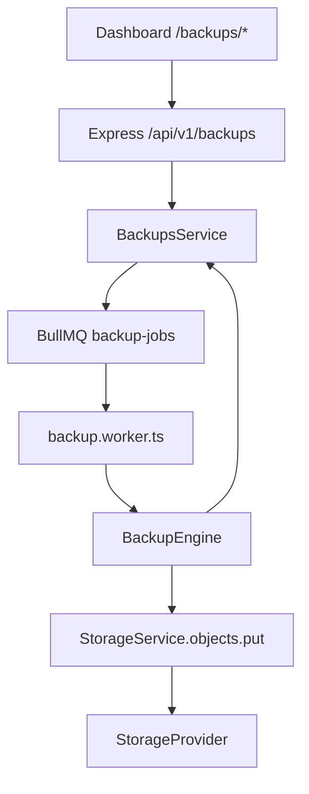
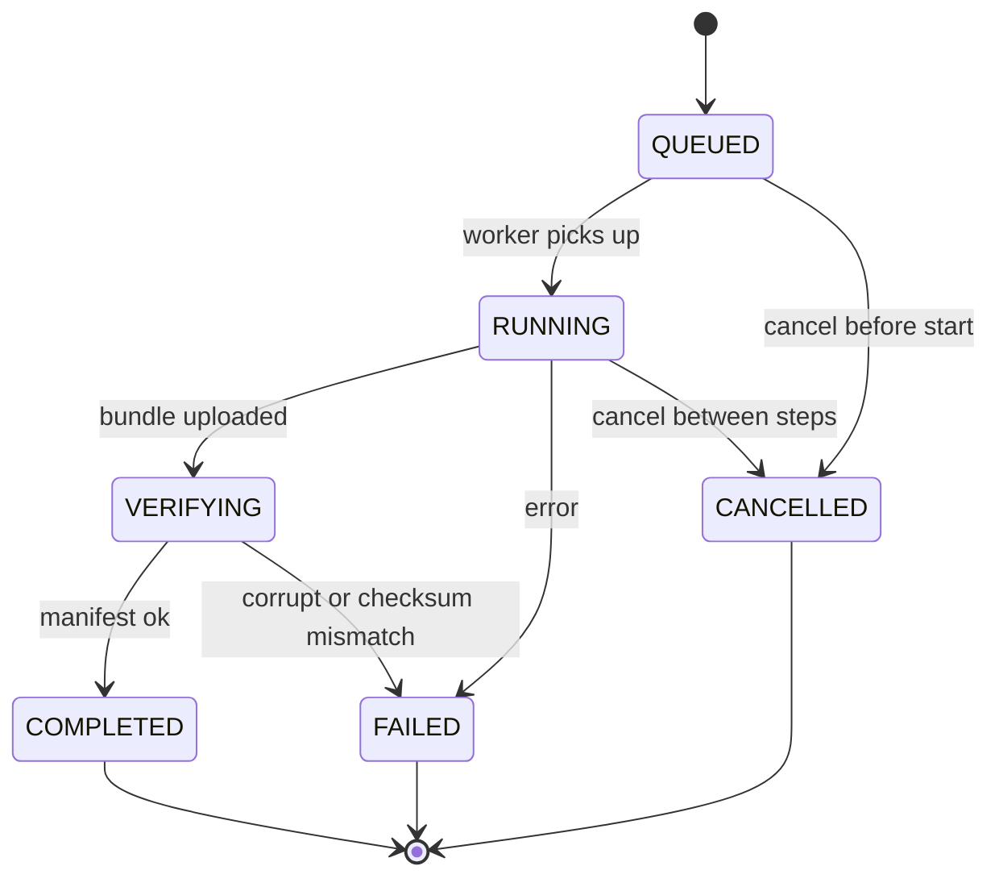

# VaultStack Phase 11–12: Backup Engine + Dashboard

## Current state

- **Permissions/RBAC ready**: `backup.read|create|restore|delete` and `BACKUP_ADMIN` role in [`packages/types/src/index.ts`](packages/types/src/index.ts). Org creators get `SUPER_ADMIN` (all permissions).
- **No backup schema or API** yet; [`docs/backups/README.md`](docs/backups/README.md) is a placeholder.
- **Worker skeleton only**: [`services/backup-worker/src/index.ts`](services/backup-worker/src/index.ts) listens on queue `backup-jobs` and returns `not_implemented`.
- **Real worker pattern**: [`apps/api/src/workers/`](apps/api/src/workers/) (artifact retention, lifecycle) uses `createAppContainer()` to reuse services + `StorageService`.
- **Storage upload path for workers**: [`ObjectService.put()`](apps/api/src/modules/storage/services/object.service.ts) streams bytes through `StorageService.resolveBucket()` → provider — **no direct MinIO/S3/filesystem in backup logic**.
- **No SSE/WebSocket** in repo — Phase 12 will use **polling** (same as other dashboard pages today).

## Target architecture



**Worker placement**: Implement the real processor in [`apps/api/src/workers/backup.worker.ts`](apps/api/src/workers/backup.worker.ts) and register it in [`apps/api/src/workers/index.ts`](apps/api/src/workers/index.ts). Update [`services/backup-worker`](services/backup-worker) to import the shared factory so a standalone process can still run the same queue consumer (matches [`docs/architecture/system-architecture.md`](docs/architecture/system-architecture.md) guidance).

---

## Phase 11 — Backup Engine

### 1. Database schema (Prisma migration)

Add org-scoped models in [`packages/database/prisma/schema.prisma`](packages/database/prisma/schema.prisma):

| Model              | Purpose                                                                                                          |
| ------------------ | ---------------------------------------------------------------------------------------------------------------- |
| `BackupSchedule`   | Cron/interval, enabled flag, `targets` (JSON enum array), `retentionDays`, `retentionCount`, `nextRunAt`         |
| `BackupJob`        | State machine, progress, error, link to schedule (nullable for manual), `targets`, `cancelRequested`, timestamps |
| `BackupSnapshot`   | Completed artifact: manifest checksum, `storageObjectId`, size, verifiedAt, expiresAt                            |
| `BackupJobLog`     | Append-only log lines (`level`, `message`, `createdAt`)                                                          |
| `BackupRestoreJob` | Restore **foundation**: status, snapshotId, restore plan JSON, no destructive restore yet                        |

**Enums**:

- `BackupJobStatus`: `QUEUED`, `RUNNING`, `VERIFYING`, `COMPLETED`, `FAILED`, `CANCELLED`
- `BackupTarget`: `POSTGRESQL`, `MONGODB`, `APP_CONFIG`, `DOCKER_VOLUMES`, `VAULTSTACK_METADATA`, `VAULTSTACK_OBJECT_METADATA`

**Rules**:

- All rows include `organizationId`; queries always filter by org from auth context.
- Backup binaries stored only via `StorageObject` reference (never in PostgreSQL).
- No credential columns on backup models — DB/Mongo/docker access uses server env only.

Migration name: `20260908190000_phase11_backups` (or next timestamp).

### 2. Config additions

Extend [`packages/config/src/index.ts`](packages/config/src/index.ts):

```ts
MONGODB_URI: z.string().url().optional();
BACKUP_DOCKER_VOLUME_PATHS: z.string().optional(); // comma-separated allowlist
BACKUP_TEMP_DIR: z.string().optional();
BACKUP_MAX_CONCURRENT_JOBS: z.coerce.number().default(1);
```

Secrets stay in env; `APP_CONFIG` target exports **redacted** keys from the Zod schema (never `JWT_SECRET`, provider keys, etc.).

### 3. Module layout

New module: [`apps/api/src/modules/backups/`](apps/api/src/modules/backups/)

```
backups/
  backups.router.ts
  controllers/backups.controller.ts
  services/
    backups.service.ts      # CRUD, enqueue, cancel, retry, retention
    backup-engine.ts        # orchestrates targets → tar.gz → upload → verify
    backup-verifier.ts      # manifest + checksum validation
  targets/
    target-registry.ts
    postgres.target.ts
    mongodb.target.ts
    app-config.target.ts
    docker-volumes.target.ts
    vaultstack-metadata.target.ts
    vaultstack-object-metadata.target.ts
  mappers/backups.mapper.ts
```

Wire into [`app-container.ts`](apps/api/src/container/app-container.ts) and mount at `/backups` in [`routes/v1.ts`](apps/api/src/routes/v1.ts).

### 4. Backup bundle format

Each job produces a **single gzip tarball** uploaded to org bucket **`vs-backups`** (lazy-created like [`ensureArtifactsBucket`](apps/api/src/modules/artifacts/services/artifacts.service.ts)):

```
manifest.json          # version, orgId, jobId, targets[], file list + sha256 per member
components/
  postgres.dump          # optional (platform target)
  mongodb/               # optional
  app-config.json        # redacted env snapshot
  docker/                # optional tar members
  vaultstack-metadata.json
  object-metadata.jsonl  # org storage object rows (metadata only)
checksum.sha256          # tarball digest
```

Upload via `storage.objects.put({ organizationId, bucketId, key, body: createReadStream(...), contentType: 'application/gzip', expectedChecksumSha256 })`.

### 5. Target adapters + org isolation

| Target                       | Scope    | Behavior                                                                                                        |
| ---------------------------- | -------- | --------------------------------------------------------------------------------------------------------------- |
| `VAULTSTACK_METADATA`        | Org      | Prisma JSON export: org, users (no secrets), roles, projects, buckets, providers (redacted), artifacts metadata |
| `VAULTSTACK_OBJECT_METADATA` | Org      | Paginated export of `StorageObject` rows for org buckets                                                        |
| `APP_CONFIG`                 | Platform | Redacted `@vaultstack/config` snapshot                                                                          |
| `POSTGRESQL`                 | Platform | `pg_dump` via `DATABASE_URL` subprocess → temp file                                                             |
| `MONGODB`                    | Platform | `mongodump` if `MONGODB_URI` set; else log `skipped`                                                            |
| `DOCKER_VOLUMES`             | Platform | Tar paths from `BACKUP_DOCKER_VOLUME_PATHS` allowlist only                                                      |

**Security gate**: `POSTGRESQL`, `MONGODB`, `DOCKER_VOLUMES`, `APP_CONFIG` require caller to have **`SUPER_ADMIN`** membership (platform-wide data). Org-scoped targets available to `backup.create`. This satisfies multi-tenant isolation while supporting disaster-recovery dumps on self-hosted installs.

Target implementations may use subprocess/temp files internally, but **must not** write backup archives to storage directly — only through `BackupEngine` → `ObjectService.put`.

### 6. Job lifecycle



- **Create**: `BackupsService.createJob()` inserts `QUEUED` row, enqueues BullMQ job `{ backupJobId, organizationId }`.
- **Progress**: update `progressPercent` (0–100) and `currentStep` during target collection, pack, upload, verify.
- **Logs**: append to `BackupJobLog` (also returned by API, never includes credentials).
- **Retry**: `POST /jobs/:id/retry` clones config into new `QUEUED` job (failed jobs only).
- **Cancel**: set `cancelRequested`; worker checks between targets/steps.
- **Verification**: standalone `POST /snapshots/:id/verify` re-downloads via `ObjectService` stream and runs `backup-verifier`; corrupt tarball → `FAILED` verification result.

### 7. Retention + cleanup

- `BackupsService.applyRetention()` deletes expired snapshots (by `retentionDays` / `retentionCount` on schedule + snapshot `expiresAt`).
- BullMQ repeat job in `backup.worker.ts` (hourly, like [`artifact-retention.worker.ts`](apps/api/src/workers/artifact-retention.worker.ts)).
- Deletion removes `StorageObject` via `storage.objects.remove()` then DB rows; audit log on delete.

### 8. Restore foundation

- `POST /api/v1/backups/snapshots/:snapshotId/restore` creates `BackupRestoreJob` (`QUEUED`).
- Worker validates snapshot manifest, builds **restore plan** JSON (which components exist, prerequisites, warnings).
- Marks job `COMPLETED` with plan — **does not** execute pg_restore/mongorestore or overwrite live data in Phase 11.
- Requires `backup.restore` permission.

### 9. REST API (org-scoped)

| Method       | Path                            | Permission                               |
| ------------ | ------------------------------- | ---------------------------------------- |
| GET          | `/backups/summary`              | `backup.read`                            |
| GET/POST     | `/backups/schedules`            | read / `backup.create`                   |
| PATCH/DELETE | `/backups/schedules/:id`        | read / `backup.create` / `backup.delete` |
| GET/POST     | `/backups/jobs`                 | read / `backup.create`                   |
| GET          | `/backups/jobs/:id`             | `backup.read`                            |
| GET          | `/backups/jobs/:id/logs`        | `backup.read`                            |
| POST         | `/backups/jobs/:id/cancel`      | `backup.create`                          |
| POST         | `/backups/jobs/:id/retry`       | `backup.create`                          |
| GET/DELETE   | `/backups/snapshots`            | read / `backup.delete`                   |
| POST         | `/backups/snapshots/:id/verify` | `backup.create`                          |
| GET/POST     | `/backups/restore`              | read / `backup.restore`                  |
| GET          | `/backups/restore/:id`          | `backup.restore`                         |

Follow [`ArtifactsController`](apps/api/src/modules/artifacts/controllers/artifacts.controller.ts) patterns: `requireOrganizationContext`, `createRequireOrganizationPermission`, Zod validation, audit on destructive ops.

### 10. Shared packages

- **Types**: `PublicBackupJob`, `PublicBackupSnapshot`, `PublicBackupSchedule`, `PublicBackupRestoreJob`, status/target enums in [`packages/types/src/index.ts`](packages/types/src/index.ts).
- **Validation**: Zod schemas in [`packages/validation`](packages/validation).
- **OpenAPI**: paths + schemas in [`packages/openapi/spec/openapi.yaml`](packages/openapi/spec/openapi.yaml).
- **API client**: methods in [`packages/api-client/src/client.ts`](packages/api-client/src/client.ts).

### 11. Tests (Phase 11)

**Unit** ([`apps/api/src/modules/backups/`](apps/api/src/modules/backups/)):

- State transitions, cancel/retry rules, retention selection, verifier (valid + corrupt manifest), target gating (SUPER_ADMIN vs org targets), redaction in app-config export.

**Integration** (`apps/api/src/integration/phase11.backups.integration.test.ts`):

- Register org → create job with org targets only → call exported `runBackupJob()` directly (avoid Redis in test) → assert `COMPLETED`, snapshot row, object in local storage.
- Failed backup (inject failing target mock).
- Retry from failed job.
- Corrupt backup → verification fails.
- Retention deletes old snapshot + storage object.
- Cancellation before/during run.

Use Testcontainers PostgreSQL + temp `STORAGE_LOCAL_ROOT` (same pattern as [`phase10.artifacts.integration.test.ts`](apps/api/src/integration/phase10.artifacts.integration.test.ts)).

**Dependency**: add `tar` (create/extract) for bundling; document `pg_dump`/`mongodump` as optional host binaries for platform targets.

---

## Phase 12 — Backup Dashboard

### 1. Routes + layout

Add [`apps/dashboard/src/pages/backups/`](apps/dashboard/src/pages/backups/) mirroring storage layout:

| Route                | Page                                                 |
| -------------------- | ---------------------------------------------------- |
| `/backups`           | Overview: recent jobs, snapshot count, quick actions |
| `/backups/jobs`      | Job list + detail drawer/modal                       |
| `/backups/schedules` | CRUD schedules, target checkboxes, retention         |
| `/backups/snapshots` | Snapshot list, verify/delete                         |
| `/backups/restore`   | Restore job list + initiate restore                  |

Register in [`App.tsx`](apps/dashboard/src/App.tsx) under `ProtectedRoute` with `BackupsLayout` sidebar nav.

### 2. UI behavior

- Use `@vaultstack/api-client` backup methods + `@vaultstack/ui` components (match storage pages styling).
- **Progress**: poll `GET /backups/jobs/:id` every 2s while status is `QUEUED|RUNNING|VERIFYING`; stop on terminal state.
- **RBAC**: hide create/delete/restore buttons unless permissions present (from `GET /auth/me` memberships/roles or permission check endpoint).
- **Restore**: separate elevated action with confirmation modal; show restore plan when foundation job completes.
- Link from storage header or top-level nav to `/backups` (minimal — add nav item in layout header).

### 3. Playwright E2E

New [`tests/e2e/backups-dashboard.spec.ts`](tests/e2e/backups-dashboard.spec.ts):

1. Register owner (SUPER_ADMIN) → navigate `/backups`.
2. Create manual backup with org-scoped targets.
3. Poll UI or API until job `COMPLETED`.
4. Assert snapshot appears on `/backups/snapshots`.
5. Start restore → assert restore job reaches `COMPLETED` with plan visible.
6. Optional: cancel a second queued job.

Use local storage driver (already in [`playwright.config.ts`](playwright.config.ts)).

---

## Documentation + Goal.md

- Replace [`docs/backups/README.md`](docs/backups/README.md) with architecture, targets, retention, security, restore foundation scope.
- Add backup section to [`docs/api/README.md`](docs/api/README.md).
- Update [`docs/architecture/database-schema.md`](docs/architecture/database-schema.md) ER diagram.
- Mark Phase 11 ✅ and Phase 12 ✅ in [`Goal.md`](Goal.md) when complete.

---

## Key conventions to follow

- **StorageService only** for backup bytes ([`AGENTS.md`](AGENTS.md) storage rules).
- **Org isolation**: every query scoped by `organizationId` from auth; platform targets SUPER_ADMIN-gated.
- **Never expose credentials** in API responses, logs, or manifests.
- **Reuse patterns** from artifacts module for bucket ensure, object delete, audit, controller structure.

## Out of scope (deferred to Phase 22 Disaster Recovery)

- Executing full PostgreSQL/MongoDB restore into live databases.
- Cross-region replication of backup objects.
- New SSE/WebSocket realtime channel (polling only unless a global realtime layer is added later).

Resume VaultStack Phase 11–12 Backup Engine + Dashboard.

Implementation is already in the repo (schema, engine, worker, dashboard, docs, Goal.md Phase 11/12 ✅). Do not re-implement.

Pending: run and fix Playwright E2E only.

1. From private-cloud-storage-platform (WSL), start API + dashboard as Playwright expects.
2. Run tests/e2e/backups-dashboard.spec.ts (BACKUP_PROCESS_INLINE=true is already in playwright.config.ts).
3. If it fails, fix the UI/API until: register → /backups → create org-target backup → job COMPLETED → snapshot verified → restore plan COMPLETED.
4. Do not edit the plan file.

Chat: [Backup Engine Dashboard](deeda394-3687-46c2-a68a-429366bad4e9)

Resume VaultStack Phase 11–12 Backup Engine + Dashboard.

Implementation is already in the repo (schema, engine, worker, dashboard, docs, Goal.md Phase 11/12 ✅). Do not re-implement.

Pending: run and fix Playwright E2E only.

1. From private-cloud-storage-platform (WSL), start API + dashboard as Playwright expects.
2. Run tests/e2e/backups-dashboard.spec.ts (BACKUP_PROCESS_INLINE=true is already in playwright.config.ts).
3. If it fails, fix the UI/API until: register → /backups → create org-target backup → job COMPLETED → snapshot verified → restore plan COMPLETED.
4. Do not edit the plan file.

Chat: [Backup Engine Dashboard](deeda394-3687-46c2-a68a-429366bad4e9)
