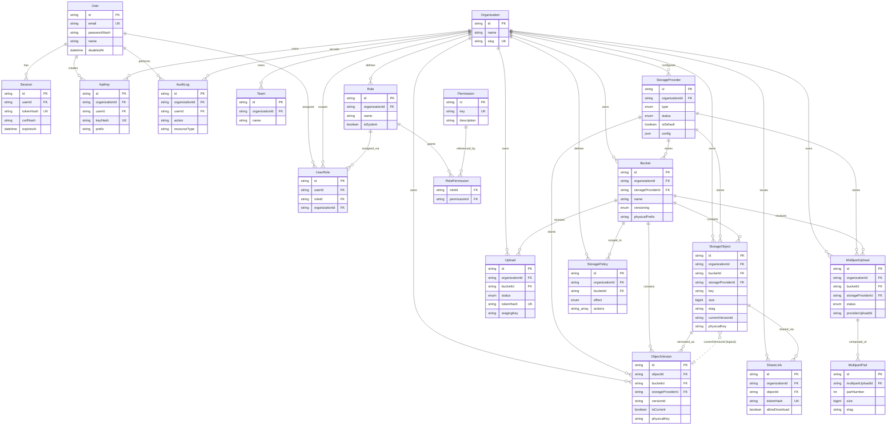

# Database schema

PostgreSQL holds **metadata only**. Object bytes live in a `StorageProvider` (local filesystem or S3-compatible backend), never in the database.

Source of truth: [`packages/database/prisma/schema.prisma`](../../packages/database/prisma/schema.prisma).

## Entity-relationship diagram

The diagram below shows every Prisma model and foreign-key relationship. `StorageObject.currentVersionId` is intentionally **not** a foreign key (see schema comment) — the dashed line marks a logical pointer only.

## Domain groups

| Domain | Models | Notes |
| --- | --- | --- |
| Identity | `User`, `Session` | Sessions store hashed tokens; plaintext never persisted |
| Tenancy | `Organization`, `Team` | Every org-owned row carries `organizationId` |
| RBAC | `Role`, `Permission`, `RolePermission`, `UserRole` | Permissions seeded from `@vaultstack/types` |
| Automation | `ApiKey` | Hashed keys; prefix shown to users |
| Audit | `AuditLog` | Append-only action log per organization |
| Storage control plane | `StorageProvider`, `Bucket`, `StoragePolicy` | Provider credentials stay in server env, not DB |
| Storage data plane | `StorageObject`, `ObjectVersion`, `Upload`, `MultipartUpload`, `MultipartPart` | Metadata only; bytes in provider |
| Sharing (future) | `ShareLink` | Foundation for Phase 8; no anonymous route yet |

## Cascade behavior

- Deleting an **Organization** cascades to all org-owned resources.
- Deleting a **User** cascades sessions, user roles, and API keys; audit logs keep the row with `userId` set null.
- Deleting a **StorageProvider** is restricted while buckets or objects reference it (`onDelete: Restrict`).
- **MultipartPart** rows cascade when their parent multipart upload is deleted.

## Keeping this diagram current

When you change `schema.prisma` (new models, fields, or relations), update this file in the same change. See [`AGENTS.md`](../../AGENTS.md) rule 21 and [`.cursor/rules/api-docs-sync.mdc`](../../.cursor/rules/api-docs-sync.mdc).
