# Database schema

PostgreSQL holds **metadata only**. Object bytes live in a `StorageProvider` (local filesystem or S3-compatible backend), never in the database.

Source of truth: [`packages/database/prisma/schema.prisma`](../../packages/database/prisma/schema.prisma).

## Entity-relationship diagram

The diagram below shows every Prisma model and foreign-key relationship. `StorageObject.currentVersionId` is intentionally **not** a foreign key (see schema comment) — the dashed line marks a logical pointer only.

```mermaid
erDiagram
    User ||--o{ Session : "has"
    User ||--o{ UserRole : "assigned"
    User ||--o{ ApiKey : "creates"
    User ||--o{ AuditLog : "performs"

    Organization ||--o{ Team : "owns"
    Organization ||--o{ Role : "defines"
    Organization ||--o{ UserRole : "scopes"
    Organization ||--o{ ApiKey : "owns"
    Organization ||--o{ AuditLog : "records"
    Organization ||--o{ ServiceAccount : "owns"
    Organization ||--o{ S3AccessCredential : "owns"
    Organization ||--o{ StorageProvider : "configures"
    Organization ||--o{ Bucket : "owns"
    Organization ||--o{ StorageObject : "owns"
    Organization ||--o{ ObjectVersion : "owns"
    Organization ||--o{ Upload : "owns"
    Organization ||--o{ MultipartUpload : "owns"
    Organization ||--o{ StoragePolicy : "defines"
    Organization ||--o{ TeamMember : "scopes"
    Organization ||--o{ ShareLink : "issues"
    Organization ||--o{ Project : "owns"
    Organization ||--o{ Build : "owns"
    Organization ||--o{ Artifact : "owns"
    Organization ||--o{ ArtifactVersion : "owns"
    Organization ||--o{ BackupSchedule : "owns"
    Organization ||--o{ BackupJob : "owns"
    Organization ||--o{ BackupSnapshot : "owns"
    Organization ||--o{ BackupJobLog : "owns"
    Organization ||--o{ BackupRestoreJob : "owns"
    Organization ||--o{ PreviewJob : "owns"
    Organization ||--o{ FolderOperationJob : "owns"
    Organization ||--o{ FolderAccessRule : "owns"

    Team ||--o{ TeamMember : "has"
    Team ||--o{ ShareLink : "receives"
    Team ||--o{ FolderAccessRule : "receives"
    User ||--o{ TeamMember : "joins"
    User ||--o{ ShareLink : "creates"
    User ||--o{ FolderAccessRule : "receives"
    User ||--o{ Project : "creates"
    User ||--o{ Build : "creates"

    ServiceAccount ||--o{ S3AccessCredential : "uses"
    ServiceAccount ||--o{ AuditLog : "performs"

    Role ||--o{ RolePermission : "grants"
    Permission ||--o{ RolePermission : "referenced_by"
    Role ||--o{ UserRole : "assigned_via"

    StorageProvider ||--o{ Bucket : "stores"
    StorageProvider ||--o{ StorageObject : "stores"
    StorageProvider ||--o{ ObjectVersion : "stores"
    StorageProvider ||--o{ MultipartUpload : "stores"

    Bucket ||--o{ StorageObject : "contains"
    Bucket ||--o{ ObjectVersion : "contains"
    Bucket ||--o{ Upload : "receives"
    Bucket ||--o{ MultipartUpload : "receives"
    Bucket ||--o{ StoragePolicy : "scoped_to"

    StorageObject ||--o{ ObjectVersion : "versioned_as"
    StorageObject ||--o{ ShareLink : "shared_via"
    StorageObject ||--o{ ArtifactVersion : "holds_bytes"
    StorageObject ||--o{ PreviewJob : "previews"
    Bucket ||--o{ FolderOperationJob : "processes"
    Bucket ||--o{ FolderAccessRule : "protects"
    StorageObject }o..o| ObjectVersion : "currentVersionId (logical)"

    Project ||--o{ Build : "has"
    Project ||--o{ Artifact : "has"
    Project ||--o{ ArtifactVersion : "has"
    Build ||--o{ Artifact : "produces"
    Build ||--o{ ArtifactVersion : "produces"
    Artifact ||--o{ ArtifactVersion : "versioned_as"

    BackupSchedule ||--o{ BackupJob : "enqueues"
    BackupSchedule ||--o{ BackupSnapshot : "retains"
    BackupJob ||--o| BackupSnapshot : "produces"
    BackupJob ||--o{ BackupJobLog : "records"
    BackupJob ||--o{ BackupJob : "retried_as"
    BackupSnapshot ||--o{ BackupRestoreJob : "restores"
    StorageObject ||--o{ BackupSnapshot : "holds_bytes"

    MultipartUpload ||--o{ MultipartPart : "composed_of"

    User {
        string id PK
        string email UK
        string passwordHash
        string name
        datetime disabledAt
        datetime totpEnabledAt
        string totpSecretCiphertext
        string totpSecretNonce
        string totpBackupCodeHashes
    }

    Session {
        string id PK
        string userId FK
        string tokenHash UK
        string csrfHash
        datetime expiresAt
        datetime revokedAt
        datetime createdAt
        datetime lastSeenAt
        string ipAddress
        string userAgent
    }

    Organization {
        string id PK
        string name
        string slug UK
    }

    Team {
        string id PK
        string organizationId FK
        string name
    }

    TeamMember {
        string id PK
        string organizationId FK
        string teamId FK
        string userId FK
    }

    Role {
        string id PK
        string organizationId FK
        string name
        boolean isSystem
    }

    Permission {
        string id PK
        string key UK
        string description
    }

    RolePermission {
        string roleId FK
        string permissionId FK
    }

    UserRole {
        string id PK
        string userId FK
        string roleId FK
        string organizationId FK
    }

    ApiKey {
        string id PK
        string organizationId FK
        string userId FK
        string keyHash UK
        string prefix
    }

    ServiceAccount {
        string id PK
        string organizationId FK
        string name
        string description
        datetime disabledAt
    }

    S3AccessCredential {
        string id PK
        string organizationId FK
        string serviceAccountId FK
        string accessKeyId UK
        string secretCiphertext
        string secretNonce
        string[] permissions
        string[] allowedBucketNames
        datetime expiresAt
        datetime revokedAt
        datetime lastUsedAt
        int requestCount
    }

    AuditLog {
        string id PK
        string organizationId FK
        string userId FK
        string serviceAccountId FK
        string action
        string resourceType
        string resourceId
        string result
        string requestId
        json metadata
        string ipAddress
        datetime createdAt
    }

    StorageProvider {
        string id PK
        string organizationId FK
        enum type
        enum status
        boolean isDefault
        json config
        string credentialRef
        string accessKeyId
        string secretCiphertext
        string secretNonce
    }

    Bucket {
        string id PK
        string organizationId FK
        string storageProviderId FK
        string name
        enum versioning
        string physicalPrefix
    }

    StorageObject {
        string id PK
        string organizationId FK
        string bucketId FK
        string storageProviderId FK
        string key
        bigint size
        string etag
        string currentVersionId
        boolean isDeleted
        string physicalKey
    }

    ObjectVersion {
        string id PK
        string objectId FK
        string bucketId FK
        string storageProviderId FK
        string versionId
        boolean isCurrent
        boolean isDeleteMarker
        string physicalKey
    }

    Upload {
        string id PK
        string organizationId FK
        string bucketId FK
        enum status
        string tokenHash UK
        string stagingKey
    }

    MultipartUpload {
        string id PK
        string organizationId FK
        string bucketId FK
        string storageProviderId FK
        enum status
        string providerUploadId
    }

    MultipartPart {
        string id PK
        string multipartUploadId FK
        int partNumber
        bigint size
        string etag
    }

    StoragePolicy {
        string id PK
        string organizationId FK
        string bucketId FK
        enum kind
        enum effect
        boolean enabled
        int days
        enum lifecycleAction
        string_array actions
    }

    ShareLink {
        string id PK
        string organizationId FK
        string objectId FK
        string teamId FK
        string tokenHash UK
        string tokenPrefix
        enum visibility
        string passwordHash
        boolean allowView
        boolean allowDownload
        int maxDownloads
        datetime expiresAt
        datetime revokedAt
    }

    Project {
        string id PK
        string organizationId FK
        string name
        string slug
        int retentionDays
    }

    Build {
        string id PK
        string organizationId FK
        string projectId FK
        int number
        enum status
    }

    Artifact {
        string id PK
        string organizationId FK
        string projectId FK
        string buildId FK
        string name
        enum kind
    }

    ArtifactVersion {
        string id PK
        string organizationId FK
        string artifactId FK
        int version
        enum status
        string storageObjectId FK
        boolean isCurrent
        boolean isRelease
        string releaseTag
    }

    BackupSchedule {
        string id PK
        string organizationId FK
        string name
        boolean enabled
        enum_array targets
        int intervalMinutes
        int retentionDays
        int retentionCount
    }

    BackupJob {
        string id PK
        string organizationId FK
        string scheduleId FK
        enum status
        enum_array targets
        int progressPercent
        boolean cancelRequested
        string retryOfJobId FK
    }

    BackupSnapshot {
        string id PK
        string organizationId FK
        string jobId FK
        string storageObjectId FK
        string manifestChecksum
        bigint size
        datetime verifiedAt
        datetime expiresAt
    }

    BackupJobLog {
        string id PK
        string organizationId FK
        string jobId FK
        enum level
        string message
    }

    BackupRestoreJob {
        string id PK
        string organizationId FK
        string snapshotId FK
        enum status
        json restorePlan
    }
```

## Domain groups

| Domain                | Models                                                                              | Notes                                                                                                                                                                                                                                                                        |
| --------------------- | ----------------------------------------------------------------------------------- | ---------------------------------------------------------------------------------------------------------------------------------------------------------------------------------------------------------------------------------------------------------------------------- |
| Identity              | `User`, `Session`                                                                   | Sessions store hashed tokens; plaintext never persisted. TOTP secrets are AES-256-GCM (`totpSecretCiphertext` + `totpSecretNonce`); backup codes are SHA-256 hashes. Plaintext authenticator secret and backup codes are returned only at setup.                             |
| Tenancy               | `Organization`, `Team`, `TeamMember`                                                | Every org-owned row carries `organizationId`. Team shares require membership.                                                                                                                                                                                                |
| Sharing               | `ShareLink`                                                                         | Public identifier is a hashed high-entropy token, never the sequential id. Password hashes, expiry, download limits, and revocation are enforced at read time.                                                                                                               |
| RBAC                  | `Role`, `Permission`, `RolePermission`, `UserRole`                                  | Permissions seeded from `@vaultstack/types`                                                                                                                                                                                                                                  |
| Automation            | `ApiKey`                                                                            | Hashed keys; prefix shown to users                                                                                                                                                                                                                                           |
| Service accounts      | `ServiceAccount`, `S3AccessCredential`                                              | Organization-scoped S3 identities. Secrets are encrypted at rest and plaintext is returned only once; credentials carry permissions, bucket restrictions, expiry, revocation, and bounded usage metadata.                                                                    |
| Audit                 | `AuditLog`                                                                          | Append-only action log per organization                                                                                                                                                                                                                                      |
| Storage control plane | `StorageProvider`, `Bucket`, `StoragePolicy`                                        | `config` holds non-secret dialect/endpoint/bucket settings. Provider secrets are AES-256-GCM (`secretCiphertext` + `secretNonce`) and never returned by APIs. ACCESS policies remain unused at request time; LIFECYCLE policies are evaluated by the worker against metadata |
| Storage data plane    | `StorageObject`, `ObjectVersion`, `Upload`, `MultipartUpload`, `MultipartPart`      | Metadata only; bytes in provider. Version ids are VaultStack-owned.                                                                                                                                                                                                          |
| CI/CD artifacts       | `Project`, `Build`, `Artifact`, `ArtifactVersion`                                   | Metadata only. `ArtifactVersion.storageObjectId` references `StorageObject` (`onDelete: Restrict`). Bytes are uploaded/downloaded/deleted through StorageService.                                                                                                            |
| Backups               | `BackupSchedule`, `BackupJob`, `BackupSnapshot`, `BackupJobLog`, `BackupRestoreJob` | Metadata only. Snapshot archives are `StorageObject` rows in org bucket `vs-backups`. Credentials are never stored on backup rows. Restore jobs store a plan JSON; they do not execute live restores.                                                                        |
| Storage operations    | `FolderOperationJob`                                                                | Durable move, copy, and delete state for recursive prefix operations. Progress cursors are persisted so BullMQ retries resume safely.                                                                                                                                        |
| Folder collaboration  | `FolderAccessRule`, `TeamMember`                                                    | Prefix ACLs are organization/bucket scoped. Direct user and team rules use the deepest matching prefix; `VIEWER` reads, `EDITOR` reads/writes, and `MANAGER` also deletes, shares, and manages ACLs.                                                                         |

## Cascade behavior

- Deleting an **Organization** cascades to all org-owned resources.
- Deleting a **User** cascades sessions, user roles, and API keys; audit logs keep the row with `userId` set null.
- Deleting a **ServiceAccount** keeps audit history with `serviceAccountId` set null.
- Deleting a **StorageProvider** is restricted while buckets or objects reference it (`onDelete: Restrict`).
- Deleting a **Team** cascades members and team-scoped share links.
- Deleting a **StorageObject** cascades its share links.
- Deleting an **ArtifactVersion** is blocked while it still references a `StorageObject` (`onDelete: Restrict`). Application code unlinks and deletes bytes via `ObjectService.remove` first.
- Deleting a **BackupSnapshot** is blocked while it still references a `StorageObject` (`onDelete: Restrict`). Application code unlinks and deletes bytes via `ObjectService.remove` first. Restore jobs restrict snapshot deletion while they exist.
- **MultipartPart** rows cascade when their parent multipart upload is deleted.

`StorageObject` has B-tree indexes for organization/bucket content type, size,
and modification time to support structured filters. Key and metadata search
remain deliberately bounded until production query volume justifies enabling a
PostgreSQL trigram or full-text index.

## Keeping this diagram current

When you change `schema.prisma` (new models, fields, or relations), update this file in the same change. See [`AGENTS.md`](../../AGENTS.md) rule 21 and [`.cursor/rules/api-docs-sync.mdc`](../../.cursor/rules/api-docs-sync.mdc).
