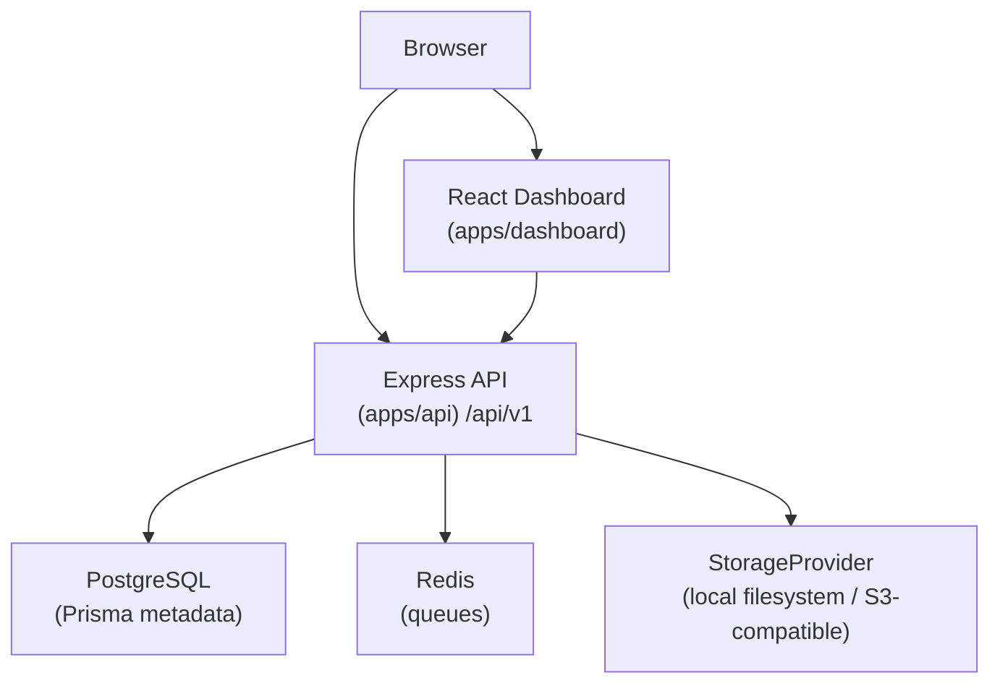

# System Architecture

VaultStack is a self-hosted control plane for private cloud storage. It is designed to run initially in Docker on a Windows development machine (WSL2) and later deploy to an Ubuntu home server.

## High-level flow

MinIO may run in development Compose as an optional S3-compatible backend; production defaults to the local filesystem provider.

## Components

### Dashboard

React + Vite + TypeScript frontend shell. No Phase 1 UI work.

### API

Express + TypeScript service.

Infrastructure:

- `GET /health` and `GET /api/v1/health` — process liveness
- `GET /ready` and `GET /api/v1/ready` — PostgreSQL + Redis
- `GET /api/docs` — Swagger UI (OpenAPI 3)
- `GET /api/openapi.json` — machine-readable OpenAPI document

Business modules under `apps/api/src/modules/`:

- `auth/` — register, login, logout, HTTP-only sessions, CSRF, API keys, `can(user, permission, resource)`
- `users/`
- `organizations/`
- `teams/`
- `roles/`
- `permissions/`
- `audit/`
- `storage/` — buckets, objects, uploads, multipart (Phase 3)

See [database schema diagram](./database-schema.md) for the full ER model and [../api/README.md](../api/README.md) for REST endpoints.

### Workers

`services/backup-worker` and `services/artifact-worker` remain BullMQ skeletons.

### Shared packages

| Package                  | Purpose                                                       |
| ------------------------ | ------------------------------------------------------------- |
| `@vaultstack/types`      | Shared TypeScript types and permission keys                   |
| `@vaultstack/validation` | Zod schemas                                                   |
| `@vaultstack/openapi`    | OpenAPI 3 spec loader for Swagger UI                          |
| `@vaultstack/config`     | Environment validation                                        |
| `@vaultstack/logger`     | Structured logging with secret redaction                      |
| `@vaultstack/api-client` | Typed HTTP client (health)                                    |
| `@vaultstack/ui`         | Shared React UI primitives                                    |
| `@vaultstack/auth`       | Password hashing, session/CSRF tokens, cookies, JWT, API keys |
| `@vaultstack/database`   | Prisma schema, client, migrations, seed                       |
| `@vaultstack/testing`    | Test helpers and Testcontainers PostgreSQL                    |

## Data storage rules

- **PostgreSQL** stores metadata only (users, organizations, roles, API keys, sessions, audit logs, storage metadata)
- File binaries must **never** be stored in PostgreSQL
- Object bytes live in a **StorageProvider** (local filesystem primary; S3-compatible optional)

See [database-schema.md](./database-schema.md) for entity relationships.

## Multi-tenancy

Organizations own resources. `organizationId` is taken from the authenticated membership + route and checked with `can()`. Client-supplied organization ids are not trusted for authorization.

## Monorepo tooling

- **pnpm** workspaces
- **Turborepo** for task orchestration
- **TypeScript** strict mode
- **Vitest** for unit/integration tests
- **Playwright** for E2E smoke tests
- **Prisma** for PostgreSQL migrations

## Infrastructure (development)

Docker Compose (`infrastructure/docker/docker-compose.dev.yml`) provides:

- PostgreSQL 16
- Redis 7
- MinIO (unused in Phase 1)
